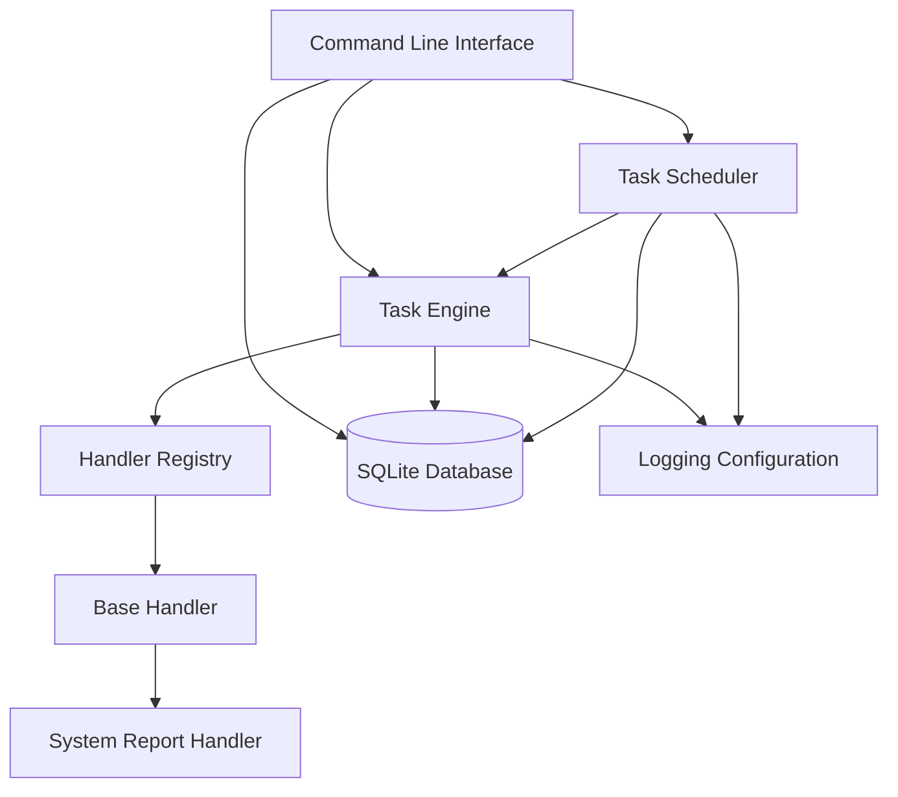
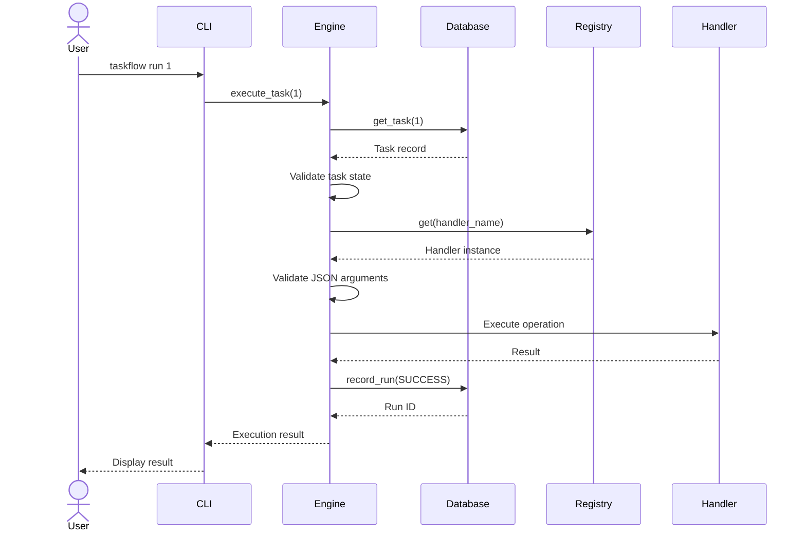
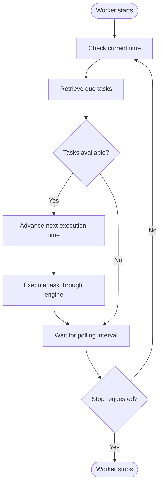
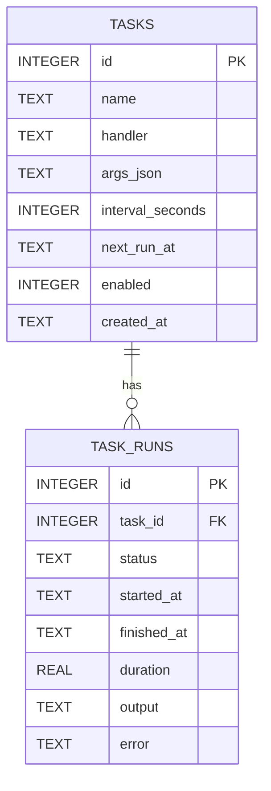

# TaskFlow Engine — Software Architecture

## 1. Introduction

TaskFlow Engine is a modular, local-first task automation application written in Python.

Its architecture separates task management, task execution, scheduling, persistence and handler implementation into independent components.

The primary architectural objective is to minimise coupling between components while maintaining a straightforward execution model.

The application currently uses:

- Python for application logic.
- SQLite for persistent storage.
- A registry for handler resolution.
- An execution engine for task processing.
- A scheduler for recurring execution.
- A command-line interface for user interaction.

## 2. Architectural overview

The application follows a layered, modular architecture.



### Architectural layers

| Layer | Main responsibility |
|---|---|
| Interface | Accepts commands and arguments from users. |
| Application | Coordinates task execution and scheduling. |
| Registry | Resolves handler implementations. |
| Handler | Performs the actual task operation. |
| Persistence | Stores task configurations and execution records. |
| Infrastructure | Provides logging and runtime support. |

## 3. Component design

### 3.1 Command-line interface

**Module:** `src/taskflow/cli.py`

The CLI is the application's primary interaction layer.

It uses Python's `argparse` module to interpret user commands and arguments.

Its responsibilities include:

- Parsing command-line arguments.
- Creating tasks.
- Listing stored tasks.
- Executing tasks manually.
- Enabling and disabling tasks.
- Deleting tasks.
- Displaying execution history.
- Listing available handlers.
- Starting the scheduler worker.

The CLI coordinates application components rather than implementing task execution itself.

**Entry points:**

- `taskflow`
- `python -m taskflow`

### 3.2 Task execution engine

**Module:** `src/taskflow/engine.py`

The task engine is responsible for executing individual tasks.

It coordinates the database and handler registry.

Its responsibilities include:

1. Retrieving a task using its identifier.
2. Verifying that the task exists.
3. Checking whether execution is permitted by the task's enabled state.
4. Resolving the handler.
5. Validating JSON arguments.
6. Executing the handler.
7. Measuring execution duration.
8. Recording the execution outcome.

The engine records both successful and failed executions.

This provides a consistent execution pathway regardless of which handler performs the operation.

### 3.3 Handler registry

**Module:** `src/taskflow/registry.py`

The registry maintains the mapping between handler identifiers and handler classes.

Example:

```python
self.register("system_report", SystemReportHandler)
```

The engine requests a handler by its registered name.

The registry then instantiates and returns the corresponding handler.

This design avoids embedding individual handler implementations inside the execution engine.

The registry currently supports:

- Handler registration.
- Handler lookup.
- Duplicate-name validation.
- Empty-name validation.
- Listing available handlers.

### 3.4 Handler interface

**Module:** `src/taskflow/handlers/base.py`

The base handler defines the expected interface for task implementations.

Concrete handlers follow this interface so that the execution engine can invoke different operations through a common contract.

The current implementation includes:

**SystemReportHandler**

Module: `src/taskflow/handlers/system.py`

This handler collects local system information, including:

- Platform.
- Operating system release.
- Machine architecture.
- Processor information.
- CPU count.
- UTC timestamp.

The handler returns structured information for the engine to process and record.

### 3.5 Scheduler

**Module:** `src/taskflow/scheduler.py`

The scheduler is responsible for identifying tasks that are due for execution.

It operates through a polling loop.

Its responsibilities include:

1. Checking the current time.
2. Retrieving eligible tasks from the database.
3. Updating the next scheduled execution time.
4. Passing due tasks to the execution engine.
5. Waiting for the next polling interval.
6. Handling graceful shutdown requests.

The scheduler uses a stop event to support controlled termination.

The current scheduling model is intended for a single local worker.

### 3.6 Database layer

**Module:** `src/taskflow/database.py`

The database layer encapsulates SQLite operations.

Other application components use its methods rather than issuing SQL queries directly.

Responsibilities include:

- Database initialization.
- Connection management.
- Transaction management.
- Task persistence.
- Task retrieval.
- Task state updates.
- Task deletion.
- Execution history.
- Due-task queries.
- Scheduled-time updates.

The database uses parameterised SQL statements for data operations.

A connection context manager handles transaction completion and connection cleanup.

### 3.7 Data models

**Module:** `src/taskflow/models.py`

The models module defines dataclasses representing task-related data.

The current models are:

- `Task`
- `TaskRun`

These provide structured representations of task configuration and execution records.

The SQLite database currently returns `sqlite3.Row` objects through the database API; the dataclasses define the corresponding application-level data structures.

### 3.8 Logging

**Module:** `src/taskflow/utils/logging_config.py`

The logging configuration provides operational visibility.

The application can report:

- Execution events.
- Scheduler activity.
- Failures.
- Operational messages.

Logging uses Python's built-in logging framework.

## 4. Task execution lifecycle

A task can be executed manually through the CLI or automatically through the scheduler.

Both pathways ultimately use the same execution engine.



### Successful execution

When a handler completes successfully:

- The result is captured.
- The execution duration is calculated.
- A successful execution record is inserted into `task_runs`.

### Failed execution

When execution raises an exception:

- The failure is captured.
- Error information is recorded.
- A failed execution record is inserted into `task_runs`.

This ensures that execution failures can be inspected through task history.

## 5. Scheduling lifecycle

The scheduler repeatedly queries the database for eligible tasks.



### Due-task criteria

A task is considered due when:

- It is enabled.
- Its execution interval is not null.
- Its next execution timestamp is not null.
- Its scheduled timestamp is less than or equal to the current time.

Eligible tasks are ordered by their scheduled execution time.

### Missed intervals

The scheduler advances the next execution time before executing a due task.

It does not replay every missed interval after downtime.

This is a skip-missed-runs scheduling policy.

### Scheduling limitations

The current implementation does not provide:

- Distributed scheduling.
- Multi-process task claiming.
- Exactly-once execution guarantees.
- Automatic retry and backoff.
- Persistent recovery of interrupted executions.

## 6. Database architecture

TaskFlow uses two principal SQLite tables.

### 6.1 Tasks

The `tasks` table stores task configuration.

| Column | Type | Purpose |
|---|---|---|
| `id` | INTEGER | Primary key. |
| `name` | TEXT | Task name. |
| `handler` | TEXT | Handler identifier. |
| `args_json` | TEXT | JSON arguments. |
| `interval_seconds` | INTEGER | Recurrence interval. |
| `next_run_at` | TEXT | Next scheduled time. |
| `enabled` | INTEGER | Task enabled state. |
| `created_at` | TEXT | Creation timestamp. |

### 6.2 Task runs

The `task_runs` table stores execution records.

| Column | Type | Purpose |
|---|---|---|
| `id` | INTEGER | Primary key. |
| `task_id` | INTEGER | Associated task. |
| `status` | TEXT | Execution outcome. |
| `started_at` | TEXT | Execution start. |
| `finished_at` | TEXT | Execution finish. |
| `duration` | REAL | Execution duration. |
| `output` | TEXT | Execution output. |
| `error` | TEXT | Error information. |

### 6.3 Entity relationship



A task can have multiple execution records.

The `task_runs.task_id` foreign key references `tasks.id`.

The relationship uses `ON DELETE CASCADE`, so deleting a task also deletes its associated execution records when foreign-key enforcement is enabled.

### 6.4 Transaction management

The database connection context manager controls transaction behaviour.

Successful operations are committed.

Exceptions trigger rollback before the connection is closed.

Foreign-key enforcement is enabled for each connection.

This centralises connection lifecycle management and reduces the risk of resource leaks.

## 7. Error handling

Error handling occurs at different levels.

| Component | Responsibility |
|---|---|
| CLI | Handles user-facing command errors. |
| Engine | Captures handler execution failures. |
| Registry | Rejects invalid handler registration and lookup. |
| Database | Rolls back failed transactions. |
| Scheduler | Logs operational execution failures and supports shutdown. |

The separation allows failures to be handled close to the component responsible for them.

Execution failures are persisted in the task history where the engine can successfully record the failure.

## 8. Design principles

### Separation of concerns

Each module has a clearly defined responsibility.

### Modularity

Handlers and application components can be extended independently.

### Abstraction

The handler base class provides a common interface for task implementations.

### Persistence

Task definitions and execution records survive application restarts.

### Resource management

Database connections are closed through a context manager.

### Testability

Components can be tested independently using Python's `unittest` framework and isolated temporary databases.

### Minimal dependencies

The current implementation relies on Python's standard library for runtime functionality.

## 9. Testing architecture

Tests are organised by component.

| Module | Coverage |
|---|---|
| `test_database.py` | Task persistence, updates, deletion, due-task queries and execution history. |
| `test_engine.py` | Execution success, failure handling and disabled tasks. |
| `test_registry.py` | Registration, lookup and validation. |
| `test_scheduler.py` | Scheduling behaviour and scheduler validation. |

Run the complete test suite:

```bash
python -W error::ResourceWarning -m unittest discover -s tests -v
```

The current baseline is 25 passing tests.

Tests use temporary databases to avoid modifying the normal application database.

## 10. Future architectural improvements

Potential improvements include:

### Execution reliability

- Atomic task claiming.
- Multi-worker coordination.
- Retry policies.
- Execution timeouts.
- Recovery of interrupted tasks.

### Scheduling

- Cron expressions.
- One-time scheduled tasks.
- Configurable missed-run policies.

### Handler architecture

- Handler-specific schemas.
- Improved argument validation.
- External handler loading.
- Handler lifecycle hooks.

### Persistence

- Versioned database migrations.
- Improved query indexing.
- Database backup and recovery.

### Observability

- Structured logs.
- Execution metrics.
- Worker health reporting.

## 11. Conclusion

TaskFlow Engine is designed as an extensible local automation framework.

Its modular structure separates task execution from scheduling, handler implementation and persistence.

The architecture provides a foundation for adding more advanced scheduling, execution reliability and observability capabilities without requiring a complete redesign of the existing application.
